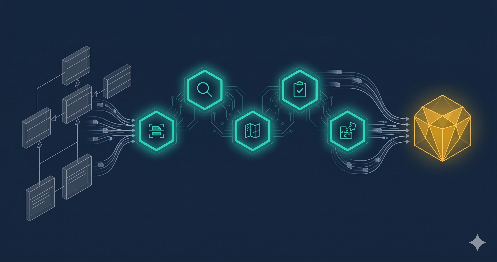

# XMI2SDC



Agentic XMI/UML to SDC4 data model converter.

XMI2SDC converts enterprise UML models exported from Sparx Enterprise Architect, MagicDraw, and other tools into SDC4-compliant data models. It uses a multi-agent pipeline to parse, analyze, map, and assemble models via the SDCStudio Assembly API.

Built for **air-gapped, self-hosted** environments. No cloud dependencies required.

## Agents

| Agent | Tools | LLM | Description |
|---|---|---|---|
| parser | 3 | No | Parse XMI files, auto-detect dialect, normalize to intermediate model |
| analyzer | 3 | Yes | Semantic analysis of class intent, inheritance, associations |
| mapper | 3 | Edge cases | Apply UML-to-SDC4 type mapping rules, produce mapping plan |
| reviewer | 2 | Yes | Review mapping completeness, generate conversion report |
| assembler | 3 | No | Execute mapping plan via SDCStudio Assembly API |
| orchestrator | -- | Yes | Multi-agent coordinator: parse, analyze, map, review, assemble |

## Type Mapping

| UML Type | SDC4 Type | Notes |
|---|---|---|
| Boolean | XdBoolean | |
| Integer (non-negative) | XdCount | |
| Integer (signed) | XdQuantity | Integer restriction |
| Real / Float / Double | XdQuantity | |
| String | XdString | |
| Enumeration | XdString | Literals become enumerations |
| Date / DateTime / Time | XdTemporal | |
| Class (composite) | Cluster | |
| Composition association | Cluster containment | |

## Installation

```bash
pip install -e .

# Development
pip install -e ".[dev]"
```

## Quick Start

### Convert an XMI file

```bash
# Configure
cp xmi2sdc.example.yaml xmi2sdc.yaml

# Parse and map (produces JSON mapping plan)
xmi2sdc convert model.xmi

# Specify output path
xmi2sdc convert model.xmi -o mapping_plan.json
```

### MCP Mode

Expose toolsets as MCP servers for LLM clients (Claude Code, Cursor, etc.):

```bash
xmi2sdc serve --mcp parser
xmi2sdc serve --mcp mapper
```

### ADK Agent Mode

For standalone agent orchestration, a local LLM is required:

```bash
ollama pull qwen2.5:7b-instruct
# Agents use ollama/qwen2.5:7b-instruct by default via LiteLLM
```

## CLI Commands

```bash
xmi2sdc convert FILE       # Parse XMI and produce SDC4 mapping plan
xmi2sdc serve --mcp AGENT  # Start MCP stdio server for an agent toolset
xmi2sdc info               # Display config summary and agent inventory
xmi2sdc validate-config    # Validate configuration file
xmi2sdc audit show         # Display audit log with filters
```

## Configuration

Create `xmi2sdc.yaml`:

```yaml
sdcstudio:
  base_url: "http://localhost:8000"
  api_key: "${SDC_API_KEY}"

cache:
  root: ".xmi2sdc-cache"

audit:
  path: ".xmi2sdc-cache/audit.jsonl"
  log_level: "standard"  # or "verbose"

output:
  directory: "./output"
```

Environment variables in `${VAR}` syntax are substituted at load time. Missing variables cause an immediate error (fail closed).

## Supported Dialects

- **Generic XMI 2.x** -- Standard OMG XMI exports
- **Sparx Enterprise Architect** -- Auto-detected via `sparxsystems.com` namespace
- **MagicDraw / Cameo** -- Auto-detected via `nomagic.com` namespace

Dialect is detected automatically from namespace declarations in the XMI file. All dialects normalize to the same `ParsedXmiModel` intermediate representation.

## Docker

```bash
docker build -t xmi2sdc .

# MCP server mode
docker run -v $(pwd)/xmi2sdc.yaml:/home/sdc/xmi2sdc.yaml:ro \
    -e XMI2SDC_AGENT=parser \
    xmi2sdc

# CLI mode
docker run -v $(pwd)/xmi2sdc.yaml:/home/sdc/xmi2sdc.yaml:ro \
    xmi2sdc info
```

## Testing

```bash
pip install -e ".[dev]"
pytest
```

## Architecture

```
XMI File ──> Parser Agent ──> ParsedXmiModel ──> Mapper Agent ──> Mapping Plan JSON
                                                                        |
                                                                        v
                               Conversion Report <── Reviewer <── Assembler ──> SDCStudio API
```

The pipeline separates **deterministic** operations (parsing, type mapping) from **LLM-assisted** operations (semantic analysis, edge-case resolution). If any stage fails, earlier results are cached and the pipeline can resume without re-processing.

## License

Proprietary. All rights reserved.

Copyright 2026 Axius SDC, LLC.
